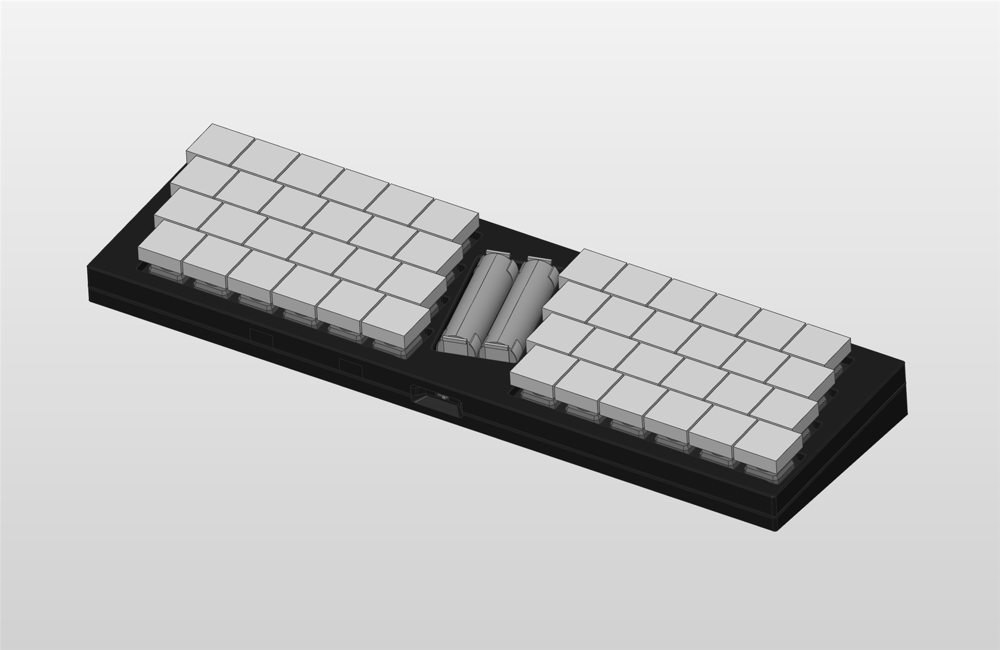
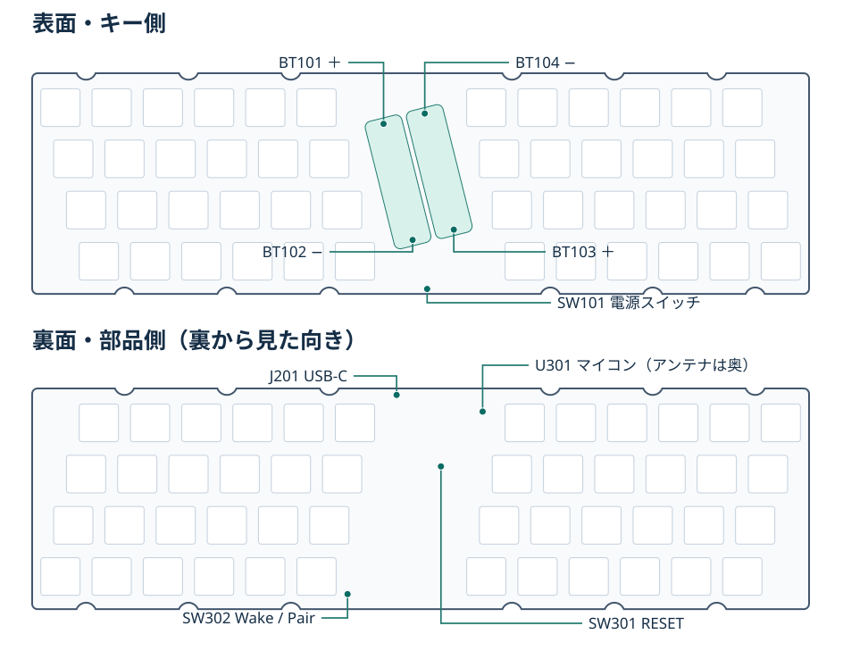
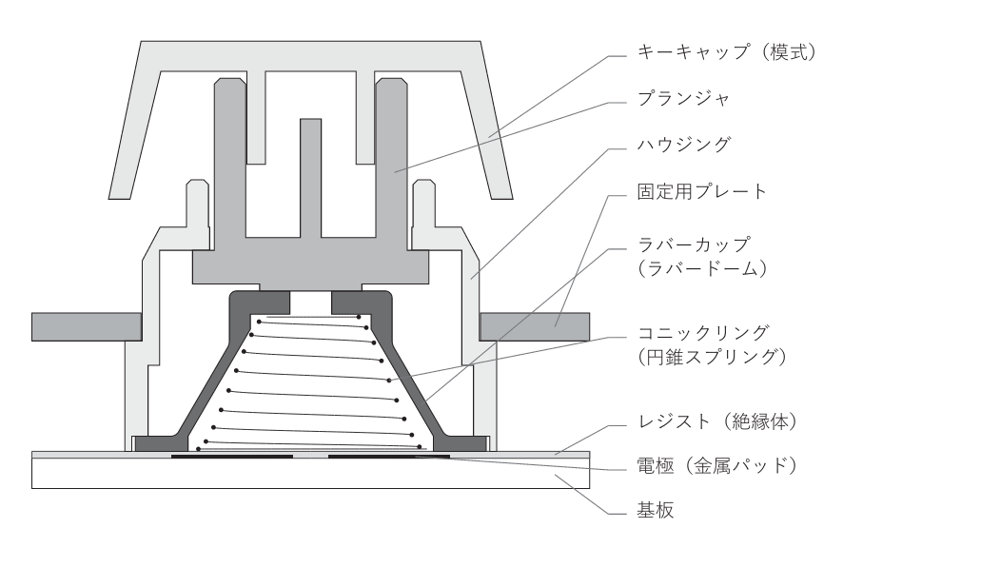
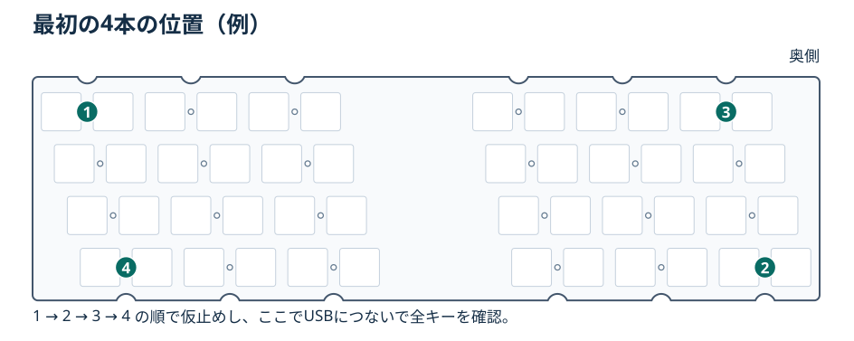
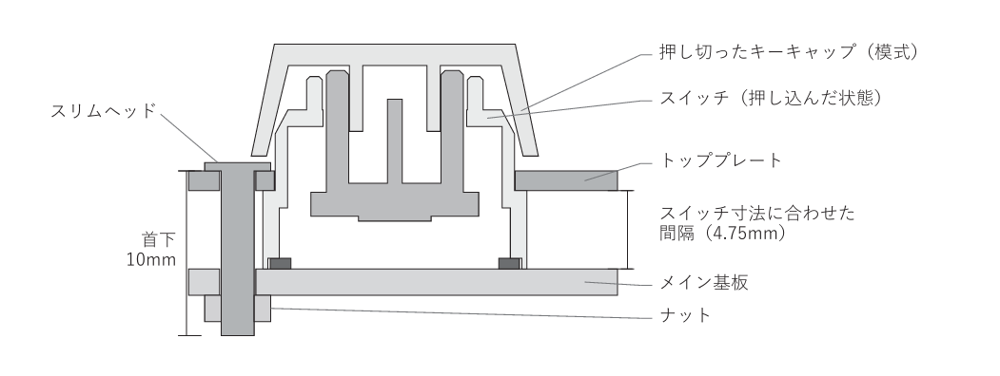
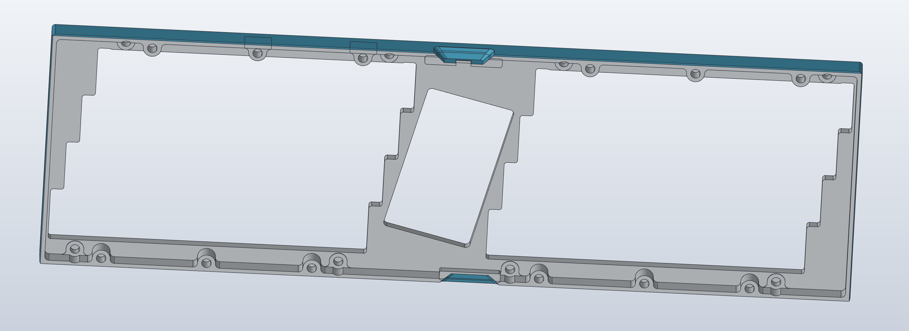
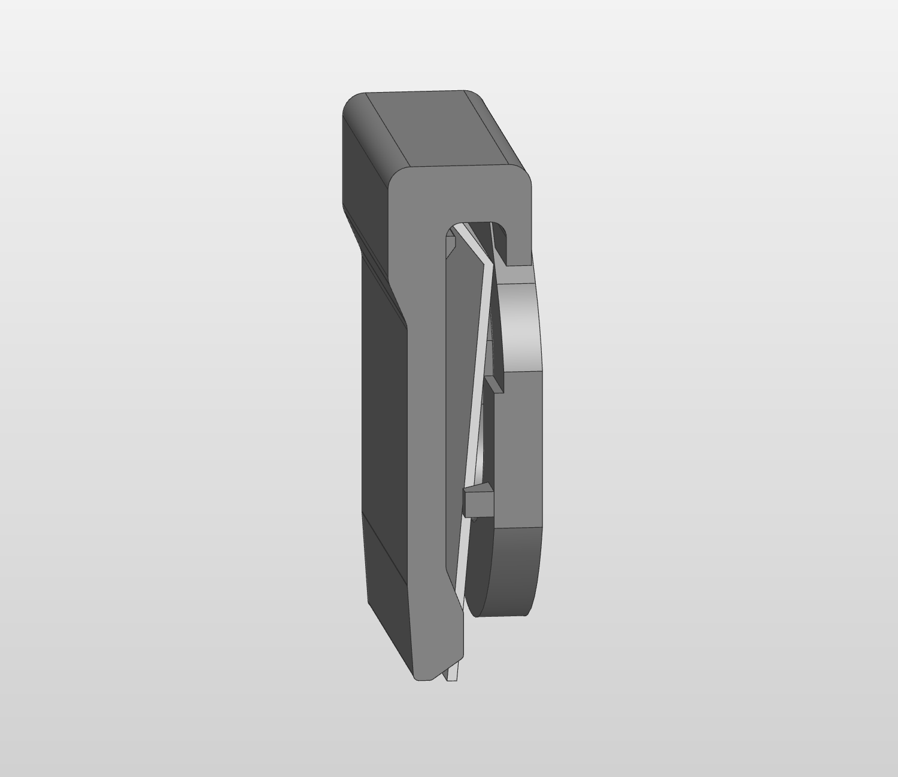

# DIELを組み立てる

対象は単3電池2本をBC-0302接点で保持するDIELです。ケースに入れる前に、4本で基板を仮止めし、USBでキーを確かめます。ケースを閉じるまで電池は外して作業します。

## 1. 足りない部品をはんだ付けする

| 部品 | 作業 |
| --- | --- |
| マイコンモジュール（U301、MDBT50Q-1MV2） | 販売用基板では実装済みの予定です。自分で実装する場合は基板の裏面に取り付け、図のとおりアンテナを奥側に向けます。 |
| 電源スライドスイッチ（SW101、MSK-12D19） | 未実装なら表面の手前に取り付けます。つまみが手前のケース開口に向くことを確認します。 |
| 電池接点（BC-0302 ×4） | 表面中央の接点です。BT101とBT103が＋側で、2本の電池は互いに逆向きです。取り付け時期はケースで異なります。 |

**FDM R1〜R3とCNC D2-SC系では、電池接点を残して先に組み立てます。** 基板を上側ケースに入れてから接点を取り付ける手順です。実装済みの接点がある場合は、ケースへの挿入経路を確かめてから作業してください。

## 2. ハウジングとスライダーをトッププレートに装着する

スライダーをハウジングに組み、キーキャップを差す軸が表に出る向きにそろえます。ハウジングは**トッププレートの裏から**はめ込みます。爪がかかり、軸が引っかからずに上下することを確かめます。

## 3. ラバーカップとスプリングを入れる

プレートを裏返し、ハウジングの中央にラバーカップを合わせます。ドームの頂点はスライダー側です。カップの内側に円錐スプリングを置き、**細い側をカップの奥、広い側を基板の電極側**に向けます。カップの縁を折り込まず、スプリングが各キーの中心に来るようにします。

図はPRECの断面を使って、共通する部品の向きと重ね方を示しています。

## 4. 主基板を重ね、4本で仮止めして動作を確認する

1. メイン基板をプレートの裏側へ、**電極面をスプリングに向けて**当てます。基板を横へ滑らせず、各キーとねじ穴をそろえます。
2. **首下10 mmのM2スリムヘッド小ねじとM2ナット**を使います。ねじ頭はキー側、ナットは主基板の裏側です。ナットをラジオペンチで軽く挟んで回り止めにし、反対側からドライバーで締めます。力を掛けすぎず、対角線を行き来しながら少しずつ締めます。
3. 下図の4本を先に仮止めします。基板を絶縁した台に置き、[診断版をUSBで書き込んで](#uf2で書き込む)全キーの押下・解放を確認します。カップやスプリングのずれはここで直しておきます。残りのねじを締めるのは、ケースに合わせた組み付け順を確認してからです。

## 5. トッププレートを上側ケースに固定する

| ケース | トッププレート → 上側ケース | 下側ケース → 上側ケース |
| --- | --- | --- |
| FDM R1〜R3 | M2×4タッピング ×8 | M2×5タッピング ×8 |
| A3-B1 レジン | M2×4小ねじ ×8（M2インサート用） | M2×6小ねじ ×12（M2インサート用） |
| CNC D2-SC Smooth Wall | M2×3なべ ×7、P2のみM2×4なべ ×1 | M2×4なべ ×8 |

- **FDM R1〜R3・CNC D2-SC系**。USBを抜き、仮止めした4本を外します。ラバーカップとスプリングの位置を保ちながら、トッププレートを上側ケースに先に固定します。CNC D2-SC系ではP1のGND端子とP2のRF窓の保持部も一緒に留めます。主基板は**USB側から斜めに差し込み**、手前を所定位置まで起こしてから、M2×10とナットで締め直します。未実装の電池接点は、基板を固定してから中央の開口から取り付け、裏からはんだ付けします。
- **A3-B1 レジン**。M2インサートを先に取り付けます。P1〜P8は HSB-203030Z、上下ケース用のCJ1〜CJ12は HSB-203045Z です。トッププレートと基板を固定し、ケース側の穴に合わせます。下側ケースを閉じる前に、基板間のねじとナットをすべて締めます。

本締め後にUSBで各キーを再確認します。4本で仮止めしたときとは基板の押さえ方が変わるので、しきい値の最終確認はこの状態で行います。

## 6. 下側ケースを合わせ、セルガードを確認する

下側ケースを合わせて、上の表で指定したケース用ねじを底側から締めます。USB-Cプラグが奥まで挿さり、手前の電源スイッチを操作できることを確認します。

電池を入れる前に、2か所の＋側接点（BT101・BT103）に**絶縁セルガードR7**を取り付けます。リングを金具の輪の内側へ入れ、後ろの脚を少し開いて上の折り返しを掛け、短い突起を金具の穴に合わせます。ガードの外れやずれがなく、平らな−極が金具に届かないことを確認します。USBも電池も外した状態で、平らな金属片をガードに当てて接点と導通しないことを確かめる方法があります。最後に単3アルカリ電池2本を基板の＋／−表示に合わせて入れます。

## UF2で書き込む

1. USBにつなぎ、SW301（RESET）を短い間隔（約500 ms以内）で2回押します。現れたUF2ドライブの `INFO_UF2.TXT` を確認します。対象はAdafruit nRF52 UF2ブートローダーとS140 v6系で、アプリ開始が `0x26000` の構成です。出荷状態が異なるモジュールや未書き込みのモジュールでは、対応するブートローダーを確認してください。
2. 初回は `diel-diagnostic.uf2` をコピーします。再起動後にUSBシリアルを開き、キーから手を離して `ec start` を実行します。
3. `ec status` で `calibrated=1`、`valid=48/48`、`errors=0` を確認します。`ec raw` で押したキーの差分が増えることを確かめ、ノイズより大きく押下時の差分より小さいしきい値を選びます。`ec thresholds <press> <release>` で試せます。実行時は全キーを離し、確定値は `config/diel.conf` に反映して再ビルドします。
4. `ec resume` で送信を許可し、全キーの押下・解放を確認します。通常版を使うときも、未押下校正のため、起動が終わるまでキーを離しておきます。
